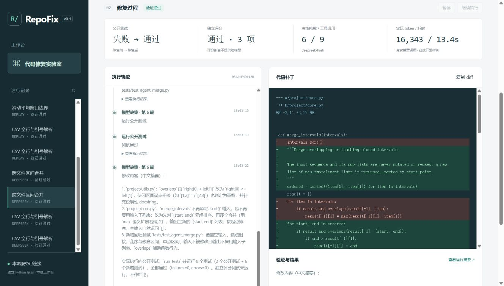

# RepoFix：基于执行反馈的代码修复 Agent

独立的 Python / 大模型应用项目。模型读取一个小型 Python 仓库，选择工具、修改源码、运行测试，依据执行反馈继续修复；最后由模型无法读取的独立测试评分。

v0.3 增加原始测试／模型新增测试分层、重复状态停止及源码检查点回滚。78项工程测试通过，三个固定场景已在真实Docker中回放验证。操作与状态规则见 [反馈协议](docs/FEEDBACK_V03.md)，历史模型试验保持原样。

最新增量完成91项工程测试，并在首次模型运行前冻结三个新合成任务，实际Docker比较单次补丁／旧反馈／分层反馈共18次。三组各6/6通过，分别使用36,410／137,080／205,800 tokens；本批次未观察到额外通过收益。106次实际模型响应均记录为`deepseek-flash`，265个证据文件哈希通过。协议、轨迹分析及复现见[三组对照](docs/PROSPECTIVE_COMPARISON.md)。这些任务已暴露，后续仅作开发或回归用途。

- 七个受限工具：列文件、读取、搜索、精确替换、补充回归测试、分层执行测试、恢复源码检查点。
- 原始测试保护、独立评分、实际 diff、逐步轨迹、token 与耗时。
- 检查点暂停与恢复、文件修改事务、轮数和用量停止阈值。
- 固定回放和真实 DeepSeek 两种模式；提供反馈迭代与单次补丁对照。
- 五个原始合成开发任务、三个固定上游函数缺陷任务与三个冻结后首次模型评估的合成任务；91项工程测试通过。后两类通过CLI显式选择，强制Docker。
- 冻结代码、任务、模型和预算；两策略历史对照及三组新对照分别记录，每任务重复运行；中断恢复保留全部尝试，失败进入分母。
- Docker CLI 后端含只读挂载、禁网、非 root 与资源上限；本机真实容器10项边界检查、超时、输出超限和清理专项验证通过。

2026-10-27新增三个MIT许可more-itertools真实缺陷的函数裁剪任务，保存父／修复提交、原文行号、哈希与许可证。`deepseek-flash`实际Docker对照6次，两策略均3/3通过；单次补丁19,779 tokens，反馈64,815 tokens（约3.28倍），未观察到额外通过收益。查看[任务与复现](docs/UPSTREAM_TASKS.md)和[原始结果](reports/deepseek-upstream-20261027.md)。这些是回顾性开发任务，不是完整仓库或未见基准评测。

此前在五个合成开发任务上，每种策略各重复两次，共20次：单次补丁10/10通过，反馈迭代9/10通过；实际 token 分别57,676与196,127。反馈失败的一次保留为达到轮数上限。查看 [原始结果](reports/deepseek-repeated-v02.md)、[失败诊断](docs/EVALUATION_V02.md) 和 [评测协议](docs/EVALUATION.md)。这批记录使用本地可信runner，与新增Docker任务分开报告。

## 当前机器直接运行

```powershell
cd D:\User\AI\repofix
.\.venv\Scripts\python.exe -m repofix.cli serve --port 8011
```

也可在本目录执行 `./start.ps1`。若本轮演示服务仍在运行，直接打开 <http://127.0.0.1:8011>。

## 新机器安装

```powershell
git clone https://github.com/INeedSomeSugar/repofix.git
cd repofix
python -m venv .venv
.\.venv\Scripts\python.exe -m pip install -e ".[dev]"
.\.venv\Scripts\python.exe -m repofix.cli serve
```

打开 <http://127.0.0.1:8011>。默认固定脚本回放，无模型调用。选择 DeepSeek 后使用进程环境的 `DEEPSEEK_API_KEY`，不会复制其他项目的密钥。也支持本目录未提交的 `.env`，环境变量优先。

```powershell
.\.venv\Scripts\python.exe -m repofix.cli doctor
.\.venv\Scripts\python.exe -m repofix.cli list
.\.venv\Scripts\python.exe -m repofix.cli run --case csv_records --provider replay
.\.venv\Scripts\python.exe -m repofix.cli run --case csv_records --provider deepseek
```

`DEEPSEEK_MODEL` 未指定时，从实际模型目录选择 `deepseek-flash` 或兼容的 `deepseek-chat`；指定的模型不在目录中则报错。当前官方接口采用 `thinking: disabled` 的工具调用流程，说明见 [DeepSeek 文档](https://api-docs.deepseek.com/guides/tool_calls/)。

## 暂停、恢复和评测

```powershell
.\.venv\Scripts\python.exe -m repofix.cli run --case csv_records --pause-after-turns 4
.\.venv\Scripts\python.exe -m repofix.cli resume <run_id>
.\.venv\Scripts\python.exe -m repofix.cli evaluate --provider replay --out reports/replay-new.json
.\.venv\Scripts\python.exe -m repofix.cli evaluate --provider deepseek --cases csv_records merge_intervals --strategies feedback single_patch --out reports/deepseek-new.json
```

每次运行位于 `work/runs/<run_id>/`，包含完整消息、事件、源码副本、diff、测试输出和摘要。该运行目录不提交。

本轮20次真实模型运行已导出261个证据文件，包含原始消息与工具结果、补丁和前后源码。校验：

```powershell
.\.venv\Scripts\python.exe scripts/verify_evidence.py --manifest reports/evidence/deepseek-v02/MANIFEST.json --report reports/deepseek-development-v02-runs.json
```

在正常 PowerShell 中运行 `./scripts/check.ps1` 检查代码和测试；脚本为每轮测试创建独立的项目内临时目录。依赖版本快照保存于 `requirements-dev.lock`，它不含包哈希，也不构成跨平台保证。

面试演示步骤、可用的简历表述和关键问答见 [演示说明](docs/DEMO_AND_INTERVIEW.md)。

## 实际界面

下图展示已经保存的 DeepSeek 跨文件修复记录，包含实际工具调用、token、独立评分和补丁。



目前只开放内置可信样例，尚未提供任意仓库上传或 shell。默认本地 runner 与20次真实模型试验都使用可信 Python 子进程。可选Docker后端已通过真实CSV回放及本机专项验证，见 [容器回放](reports/docker-replay-20261027.json)、[边界验证](docs/DOCKER_VALIDATION.md) 和 [公开范围](docs/PUBLICATION.md)。

固定回放仅验证工程流程。真实模型运行、独立评分和工程测试分别记录，不能混作模型效果。内置任务是自行编写的合成开发样例，不是 SWE-bench。
