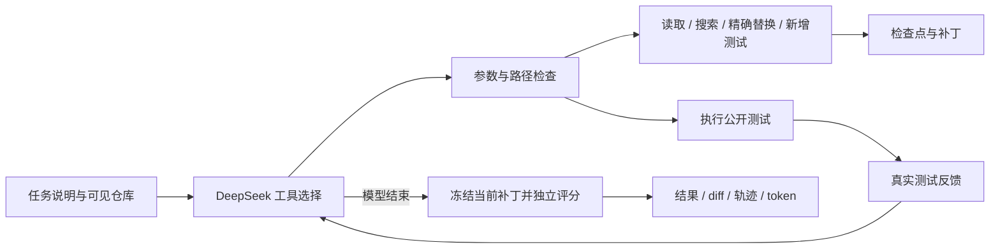

# 架构与设计取舍

RepoFix 的第一版围绕小型、纯 Python 代码修复任务建立可检查的执行过程。DeepSeek 根据对话选择工具，程序负责参数校验、执行、持久化和评分。



## 模型与程序各自负责什么

模型决定读取哪些文件、搜索什么、修改哪些具体代码以及下一步是否运行测试。这部分是基于工具返回结果的动态决策。

程序固定执行权限、原始文件保护、调用次数及时间预算、状态保存和最终评分。模型的自然语言总结不能把任务状态直接改成通过。

初版使用显式 Python agent loop，便于查看每一条模型消息与工具结果；未引入 LangGraph 或多智能体。状态和事务足够小时，显式实现便于调试和面试解释；复杂分支、并行子任务或跨服务调度增加后，再评估编排框架的收益。

## 文件与工具边界

每次运行生成独立 UUID 目录，包含：

```text
work/runs/<run_id>/
  repository/           # 模型可读取的工作副本
  original/             # 原始副本，只用于完整性校验和 diff
  independent_tests/    # 评分断言，不暴露给模型工具
  transactions/         # 文件修改意图与前后 SHA-256
  run.json              # 消息、待执行工具、预算和状态
  events.jsonl          # 逐步调用记录
  patch.diff            # 由文件差异实际生成
  summary.md            # 运行摘要
  logs/                 # 测试子进程输出
```

六个工具：`list_files`、`read_file`、`search_code`、`replace_text`、`write_test`、`run_tests`。

`replace_text` 只允许修改已有的 `project/*.py`，旧文本必须精确匹配一次。原始测试、说明及文件集合受到哈希校验保护。Agent 可以新增 `tests/test_agent_*.py`，不能删除原测试或把断言改成通过。

## 检查点与恢复

模型响应和待执行工具列表先写入 `run.json`，再逐条执行工具。文件修改先保存事务意图，包含请求签名、修改前后哈希，再原子替换源码。若进程在修改完成、结果保存前退出，恢复时通过事务记录识别已完成的修改。

读取、搜索和测试可以在崩溃后重新执行。它们不承诺通用的 exactly-once 语义；文件修改具有针对同一工具调用 ID 的恢复机制。运行锁由操作系统释放，避免进程崩溃留下永久忙碌状态。

Windows 下 JSON 轮询读取可能短暂阻止原子重命名，检查点写入会有限重试并保留旧文件；该问题有专门测试覆盖。

## 执行隔离的实际范围

当前只开放内置可信合成样例，不接受任意仓库、任意 shell 或在线安装依赖。执行器使用独立 Python 子进程、`-I -S -B`、环境变量白名单、固定测试入口、超时和输出上限；API Key 不传入测试子进程。源码采用保守 AST 规则限制导入、反射和动态执行。

这些措施是演示范围内的约束。v0.2新增可选Docker后端，预检本机Linux engine后固定镜像ID，以只读挂载、禁网、非root和资源上限执行；不可用时在模型调用前失败，不回退本地。2026-10-27已完成真实CSV容器回放与清理验证，并兼容Docker29小写的不存在提示。文件系统、网络、超时和内存完整边界仍需专项实测，之后才考虑扩大仓库范围。细节见 [v0.2记录](EVALUATION_V02.md)。

机器评分通过可信 harness 的独立结果文件返回，不从待测代码的 stdout 中解析“通过”标记。样例程序自行打印伪造结果、提前退出或超时，不能获得通过状态。

## 重复实验协议

`experiments.py` 冻结精确模型、任务哈希、源码摘要、预算、策略和重复顺序；策略按任务／重复序号交错。OS锁避免并发推进，运行ID先落盘再调用模型。完成的运行包括错误均跳过隐式重试；源码或任务变化拒绝恢复。报告保留失败分母、逐任务配对、token及耗时分布，回放不计真实模型修复率。

## API 与前端实现

FastAPI 服务只绑定 `127.0.0.1`。本地执行队列为单 worker，跨来源写请求被拒绝。页面使用原生 HTML/CSS/JavaScript，动态代码、模型文本和 diff 通过 `textContent` 渲染，避免作为 HTML 执行。UI 默认选择不调用 API 的回放模式。

密钥从服务进程的 `DEEPSEEK_API_KEY` 获取，可选读取项目未跟踪的 `.env`。服务只返回“是否存在凭据”，不返回值；上游错误不打印响应正文或认证请求对象。
